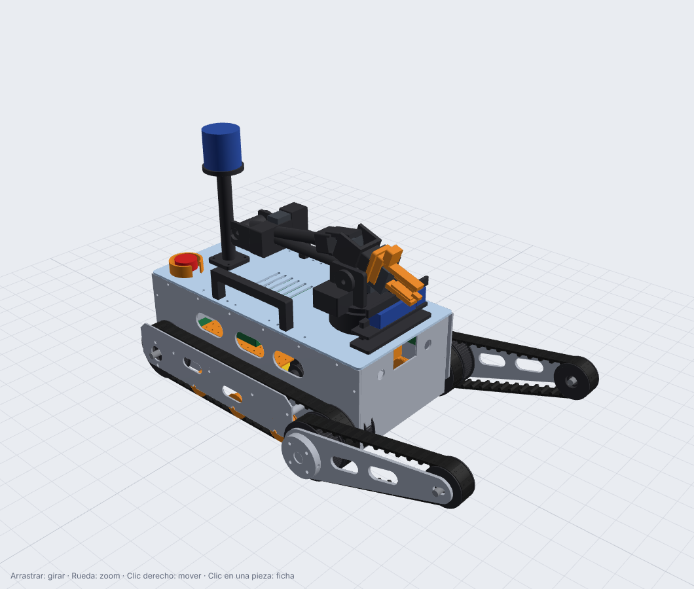

# Carpincho URB-R1 · Robot de rescate de UruBots

Robot terrestre de rescate de **[UruBots](https://github.com/UruBots)** (UTEC, Rivera, Uruguay) para la
**RoboCup Rescue Robot League** y las competencias de rescate de la **FIRA**, temporada 2027.



Proyecto **nuevo, pensado para 2027**: no reutiliza robots, hardware ni código de temporadas anteriores.
Este repositorio es el **megaproyecto completo**: planificación, diseño 3D paramétrico, piezas para fabricar,
guía de armado, electrónica y cableado, firmware, software ROS 2 (teleoperación, percepción, mapeo y
autonomía), plan de pruebas, checklists de competencia y solución de errores.

| | |
|---|---|
| **Tipo** | Orugas con 2 flippers delanteros + brazo de 5 GDL con pinza |
| **Medidas** | 519 × 414 mm (759 mm con flippers extendidos) · ≈ 17 kg |
| **Movilidad** | Escaleras de 45° (apoya en 2.3 escalones a la vez), rampas, K-rails, stepfields, grava |
| **Cómputo** | Jetson Orin Nano Super (ROS 2 Jazzy LTS) + ESP32-S3 (tiempo real) |
| **Sensores** | Livox Mid-360 (3D), RGB-D, térmica 256×192, 3 cámaras USB, IMU, Hall en la pinza, audio |
| **Software** | FAST-LIO, detección de QR/hazmat/movimiento/térmica, POIs en el mapa, exportación GeoTIFF/PLY/CSV del reglamento, carril autónomo |
| **Costo estimado** | ≈ 3 900 USD ([BOM](hardware/bom.md)) |

> **Estado (31/10/2026)**: diseño de referencia v0.1. El CAD, el firmware y el software **compilan y pasan sus
> tests**, y el puente ROS ↔ placa base se probó contra un simulador de la placa. **Todavía no hay un robot
> físico**: las medidas de motores y sensores comprados y las ganancias de control se tienen que validar con
> el prototipo (ver el [plan](docs/00-plan/plan-maestro.md)).

## Por dónde empezar

| Si sos de… | Leé primero |
|---|---|
| Todo el equipo | [Plan maestro](docs/00-plan/plan-maestro.md) · [Reglamento y estrategia](docs/01-reglamento/reglamento-y-estrategia.md) · [Arquitectura](docs/02-arquitectura/arquitectura.md) |
| Mecánica | [Diseño mecánico](docs/03-mecanica/diseno-mecanico.md) · [Piezas](docs/03-mecanica/piezas.md) · [Cálculos](docs/03-mecanica/calculos.md) · [Guía de armado](docs/06-armado/guia-de-armado.md) · [Visor 3D](visor/) |
| Electrónica | [Electrónica, potencia y cableado](docs/04-electronica/electronica.md) · [BOM](hardware/bom.md) |
| Firmware | [Firmware y protocolo](docs/05-software/firmware.md) |
| Software | [Instalación del Jetson](docs/05-software/setup-jetson.md) · [ROS 2](docs/05-software/ros2.md) · [Percepción](docs/05-software/percepcion.md) · [Mapeo y autonomía](docs/05-software/mapeo-y-autonomia.md) · [Comunicaciones](docs/05-software/comunicaciones.md) · [Calibración](docs/05-software/calibracion.md) |
| Operadores | [Checklists de competencia](docs/07-pruebas/checklist-competencia.md) · [Solución de errores](docs/08-errores/solucion-de-errores.md) |
| Pruebas | [Plan de pruebas](docs/07-pruebas/plan-de-pruebas.md) · [Arena casera](docs/07-pruebas/arena-de-pruebas.md) |

Índice completo: [docs/README.md](docs/README.md). Tareas: [backlog](docs/00-plan/backlog.md).

## Estructura

```
cad/                 Diseño 3D paramétrico (CadQuery, Python)
  carpincho_cad/params.py   ← ÚNICA fuente de verdad de las dimensiones
  build.py                  → genera cad/out/: STEP, STL, DXF, ensamble GLB, masa y CG, xacro del URDF
visor/               Visor 3D web (three.js): ensamble, despiece, fichas y descargas
hardware/            BOM (CSV + tabla), costos
firmware/            ESP32-S3: PlatformIO + tests de PC del protocolo y de los controladores
ros2_ws/src/         Paquetes ROS 2 carpincho_* (interfaces, descripción, base, brazo, teleop, percepción,
                     autonomía, bringup)
operator/            Estación de operador: layout de Foxglove, audio PTT, descarga de misión
tools/               Simulador de placa base, herramienta de servos, generador de docs, capturas
docs/                Toda la documentación (plan → reglamento → arquitectura → mecánica → electrónica →
                     software → armado → pruebas → errores)
```

## Inicio rápido

```bash
# 1. CAD: regenerar piezas, ensamble, masa/CG y URDF (≈ 1-2 min)
pip install -r cad/requirements.txt
python cad/build.py && python tools/gen_docs.py

# 2. Visor 3D (abrir http://localhost:8000/visor/)
python -m http.server 8000

# 3. Firmware: tests en la PC y compilación
g++ -std=c++17 -I firmware/carpincho_base/include firmware/carpincho_base/test_host/test_protocol.cpp -o /tmp/t && /tmp/t
cd firmware/carpincho_base && pio run

# 4. ROS 2 Jazzy (Ubuntu 24.04)
cd ros2_ws && colcon build && colcon test && colcon test-result --verbose

# 5. Probar el robot sin robot
python3 tools/fake_base.py                                     # → /dev/pts/N
ros2 run carpincho_base base_bridge --ros-args -p port:=/dev/pts/N -p auto_enable:=true
ros2 launch carpincho_bringup operator.launch.py              # joystick
```

## Cómo contribuir

1. Rama corta desde `main` → cambios → `colcon test` y tests del firmware → PR con revisión de 1 persona.
2. Si tocás dimensiones: **solo** en `params.py`, y después `cad/build.py` + `tools/gen_docs.py` +
   `tools/check_interferences.py` + `node tools/render_views.mjs`, todo en el mismo PR.
3. Si aprendiste algo en la pista: agregalo a [solución de errores](docs/08-errores/solucion-de-errores.md).

## Licencia

[MIT](LICENSE): software y diseño abiertos, como el resto de los proyectos de UruBots.
