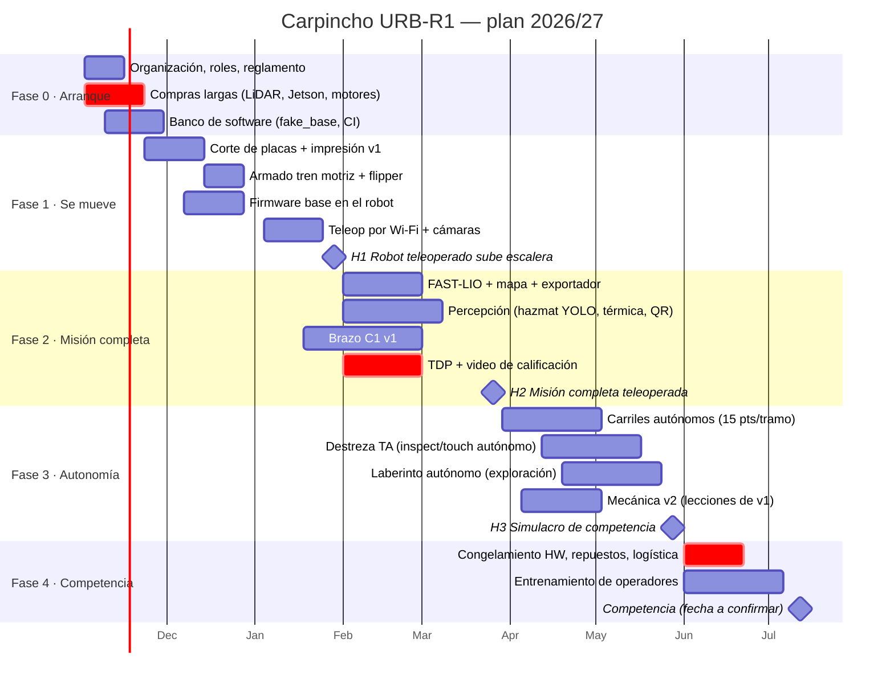

# Plan maestro: Carpincho URB-R1 rumbo a 2027

> Estado: **v0.1 (31/10/2026)**, diseño de referencia completo y software base compilando y con tests.
> Todavía no hay robot físico: los números de este plan son estimaciones para validar con el prototipo.
> **Es un proyecto nuevo para 2027**: no se apoya en robots, hardware ni código de temporadas anteriores de
> UruBots (todo eso quedó desactualizado). Lo que haya en el laboratorio se puede usar, pero el plan no depende de eso.

## 1. Objetivo

Construir un robot terrestre de rescate **propio de UruBots** que pueda:

1. **Moverse** por todos los carriles del reglamento RoboCup Rescue (rampas de 15°/30°, K-rails,
   stepfields, grava, pallets de 20 a 30 cm, **escaleras de 45°**, puertas).
2. **Hacer tareas de destreza**: inspeccionar (QR, hazmat), tocar e insertar, apretar botones y girar válvulas.
3. **Sensar víctimas**: térmica, hazmat, movimiento, QR, imán (Hall) y audio en dos sentidos.
4. **Mapear el laberinto** en 2D y 3D y ubicar los objetos (GeoTIFF + PLY + CSV automáticos).
5. **Hacerlo en forma autónoma**, porque ahí está el puntaje: una pasada autónoma vale **15 puntos**
   contra 1 teleoperada, y la destreza autónoma multiplica por 10 o por 20.

Categoría objetivo: **RoboCup Rescue Robot League 2027** (mientras no salga el reglamento 2027, se usa como base el
último publicado, el **2026D**; ver la sección 1 de [reglamento](../01-reglamento/reglamento-y-estrategia.md)). El mismo robot sirve
para la categoría de rescate terrestre de la **FIRA** si se abre en 2027; ver
[docs/01-reglamento](../01-reglamento/reglamento-y-estrategia.md), donde se explica qué hay que
confirmar en cuanto salgan las reglas FIRA 2027.

## 2. Principios de diseño

- **Una sola fuente de verdad**: las dimensiones viven en `cad/carpincho_cad/params.py`. El CAD, el URDF,
  los cálculos y las tablas de esta documentación se **generan** desde ahí.
- **Todo probable sin robot**: el simulador de la placa base (`tools/fake_base.py`) y los tests de PC permiten
  que el equipo de software avance mientras mecánica fabrica.
- **Fabricable en Uruguay**: placas de aluminio cortadas con láser o chorro de agua, impresión 3D y
  correas y rodamientos estándar. Lo importado (sensores, motores) se compra **primero**, porque tarda.
- **Robusto antes que lindo**: la correa del flipper funciona como fusible mecánico, hay watchdogs en el
  firmware y en ROS, y el E-stop desarma de verdad.
- **Autonomía incremental**: primero carriles rectos (lógica simple y probada), después destreza
  "teleop approach + auto manipulation" (×10) y al final el laberinto autónomo (×5).

## 3. Cronograma (noviembre 2026 a julio 2027)

> Las fechas de calificación y de los eventos 2027 **hay que confirmarlas** en
> [rrl.robocup.org](https://rrl.robocup.org) y [firaworldcup.org](https://firaworldcup.org). Hasta ahora,
> la calificación de RoboCup (TDP + video) se pidió entre febrero y marzo, y los mundiales fueron en julio.

### Hitos y criterio de "terminado"

| Hito | Fecha | Criterio medible (si no se cumple, no está terminado) |
|---|---|---|
| **H0** Banco listo | 27/11 | `colcon test` en verde; teleop con `fake_base` desde la notebook del operador por Wi-Fi |
| **H1** Se mueve | 29/01 | 10 subidas y bajadas seguidas de la escalera de 45° de la arena, teleoperado, sin intervención |
| **H2** Misión completa | 26/03 | Una prueba de 20 min en la arena con mapa + 5 POIs en CSV, inspección con el brazo y cajón de víctimas |
| **H3** Simulacro | 28/05 | 3 carriles con ≥ 6 pasadas autónomas en total; laberinto con archivos válidos entregados en < 5 min |
| **H4** Competencia | jul. | Robot + 2 juegos de repuestos críticos + 3 operadores entrenados |

## 4. Equipo y roles

| Rol | Personas | Responsable de |
|---|---:|---|
| Capitán / gestión | 1 | plan, compras, reuniones, relación con UTEC y organizadores |
| Mecánica | 2-3 | CAD (`cad/`), fabricación, armado, mantenimiento, repuestos |
| Electrónica | 2 | potencia, E-stop, arneses, PCB de la placa base, baterías |
| Firmware | 1 | `firmware/`, protocolo, calibración de motores |
| Software ROS 2 | 3 | base y TF (1), percepción (1), mapeo y autonomía (1) |
| Operadores | 2-3 | entrenamiento semanal, interfaz Foxglove, checklist de pista |
| Documentación / TDP / medios | 1 | TDP, video de calificación, póster, redes |

Una persona puede tener dos roles. Para cada subsistema conviene tener **dos personas que lo sepan
arreglar**: en la competencia los problemas aparecen de a varios a la vez.

### Ritmo semanal

- **Lunes**: planificación de 30 min. Se mueven tarjetas en el tablero (GitHub Projects con las tareas de
  [backlog.md](backlog.md)).
- **Jueves**: integración. Todo lo que está en `main` se prueba en el robot y se anota en el registro de pruebas.
- **Sábado**: día de pista, con pruebas cronometradas en la arena y un operador distinto cada semana.
- Regla de ramas: `main` siempre compila y pasa la CI. Se trabaja en ramas cortas con PR y revisión de 1 persona.

## 5. Presupuesto

Detalle en [hardware/bom.md](../../hardware/bom.md). Resumen (USD, orientativo):

| Rubro | USD |
|---|---:|
| Sensores (LiDAR 3D, RGB-D, térmica, cámaras) | ≈ 1 400 |
| Potencia (3 baterías, cargador, E-stop, conversores) | ≈ 570 |
| Mecánica (placas, transmisión, filamento) | ≈ 630 |
| Cómputo (Jetson + ESP32) | ≈ 310 |
| Comunicaciones (2 routers, hub, joysticks) | ≈ 290 |
| Motores y drivers | ≈ 200 |
| Brazo | ≈ 190 |
| Contingencia | ≈ 300 |
| **Total** | **≈ 3 900** |

Hay **plan B de menor costo para los ítems caros** (ver la BOM). Mientras llegan las compras, el software se
desarrolla con el simulador de la placa base (`tools/fake_base.py`) y la CI: no hace falta hardware.

## 6. Riesgos principales

| # | Riesgo | Prob. | Impacto | Mitigación |
|---|---|---|---|---|
| R1 | Las compras importadas demoran más de 6 semanas | Alta | Alto | Comprar LiDAR, Jetson y motores en la **semana 1**. Desarrollo con `fake_base` mientras tanto |
| R2 | Los tacos de TPU se despegan de la correa | Media | Alto | Probar 3 métodos de fijación en el mes 1; plan B: correa con tacos soldados de fábrica |
| R3 | El flipper no levanta el robot (torque, patinamiento de correa) | Media | Alto | Prueba en banco con pesas en H1; reductora 56 mm 1:264 + correa 2.14:1 con margen 1.6×; plan B 1:369 |
| R4 | El Wi-Fi se cae en la competencia (radio degradada) | Alta | Alto | Autonomía que sigue sin enlace; video comprimido; prácticas con la caja de degradación (5 Mbps, 10 % de pérdida, 100 ms) |
| R5 | **Baterías prohibidas en el avión** (> 160 Wh) | Alta | Crítico | Ver la sección 7. Para viajar: packs ≤ 100 Wh |
| R6 | Se quema un driver o un servo en la competencia | Media | Medio | 2 juegos de repuestos, conectores enchufables, procedimiento de cambio en < 10 min |
| R7 | Pocas horas de práctica de los operadores | Alta | Alto | Día de pista semanal desde H1 y rotación de operadores |
| R8 | El modelo hazmat falla con la iluminación del lugar | Media | Medio | Dataset con aumentaciones fuertes; recolectar imágenes en el lugar el día 1 y re-entrenar |
| R9 | Gente que deja el equipo a mitad de año | Media | Alto | Dos personas por subsistema; todo documentado en este repo |
| R10 | El reglamento 2027 cambia pruebas o formatos | Alta | Medio | Revisar cada borrador apenas sale; el diseño cubre las pruebas estándar del NIST que se repiten cada año |

## 7. Logística de viaje (no dejar para el final)

- **Baterías**: el pack de diseño (6S2P de 10 Ah) tiene **216 Wh**, y en avión de pasajeros solo se permiten
  baterías de litio de hasta 100 Wh sin trámite, y de 100 a 160 Wh con autorización de la aerolínea (máx. 2). Para viajar,
  armar packs **6S1P de 21700 de 4.5 Ah (≈ 97 Wh)**, que se cambian más seguido, o comprar las celdas en
  destino y armarlas allá. **Confirmar con la aerolínea** con anticipación.
- Valija rígida con espuma cortada a medida para el robot, una caja de repuestos y una de herramientas.
- Llevar adaptadores de enchufe, una zapatilla, el router de la estación y **dos** joysticks.
- Documentación de aduana de los componentes (facturas) si se viaja fuera del Mercosur.

## 8. Decisiones tomadas (registro)

| Fecha | Decisión | Por qué |
|---|---|---|
| 31/10/2026 | Robot de orugas con 2 flippers delanteros sobre un mismo tubo | Simple (1 actuador), sube escaleras de 45° (apoya en 2.3 narices) |
| 31/10/2026 | Correa HTD 5M como oruga + tacos de TPU | Repuestos estándar y baratos; poleas imprimibles |
| 31/10/2026 | Reductora 1:51 en tracción (no 1:27) | Con 1:27 el torque nominal no alcanzaba para la escalera con 20 kg |
| 31/10/2026 | ESP32-S3 + protocolo COBS/CRC propio (no micro-ROS) | Depurable, testeable en PC, sin dependencias en el MCU |
| 31/10/2026 | Livox Mid-360 + FAST-LIO | El PLY 3D del laberinto puntúa la mitad del mapeo; LIO funciona en rampas |
| 31/10/2026 | Brazo con servos STS3215 (bus serie) | Baratos, con realimentación; misma familia que SO-100/SO-101 para practicar |
| 31/10/2026 | ROS 2 **Jazzy** (no Humble) | Humble termina su soporte en mayo de 2027, antes de la competencia; Jazzy es LTS hasta 2029 |
| 31/10/2026 | Proyecto desde cero, sin heredar robots ni código anteriores | Lo previo del equipo quedó desactualizado para 2027 |
