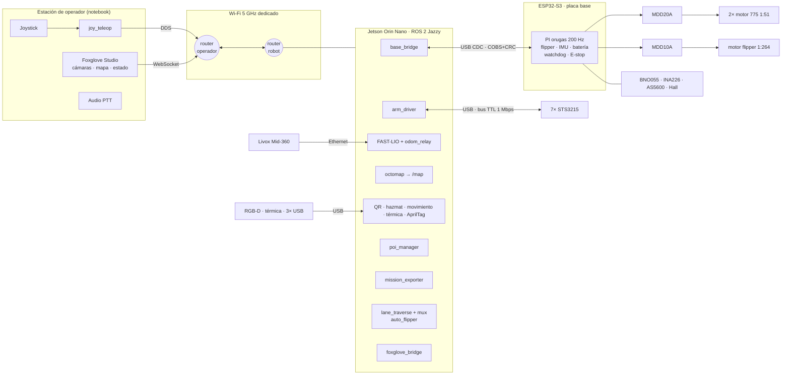
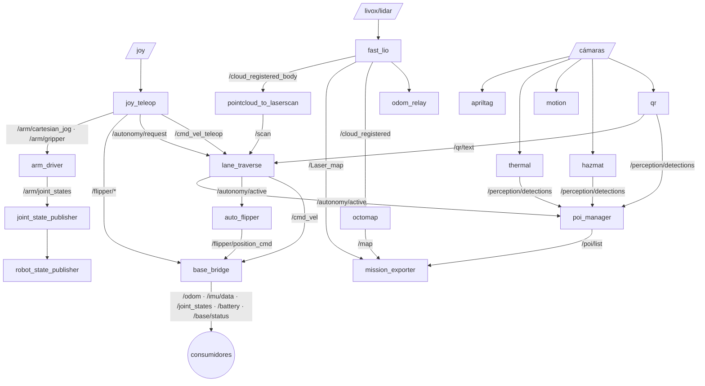
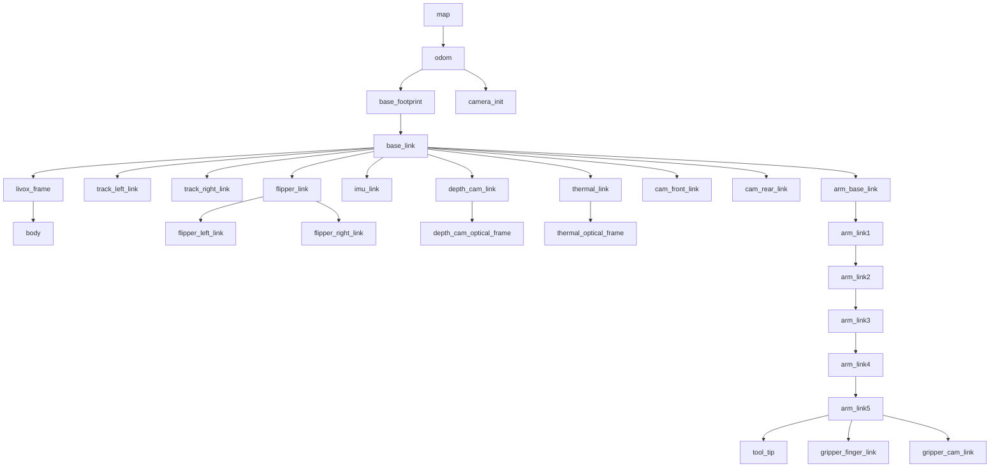
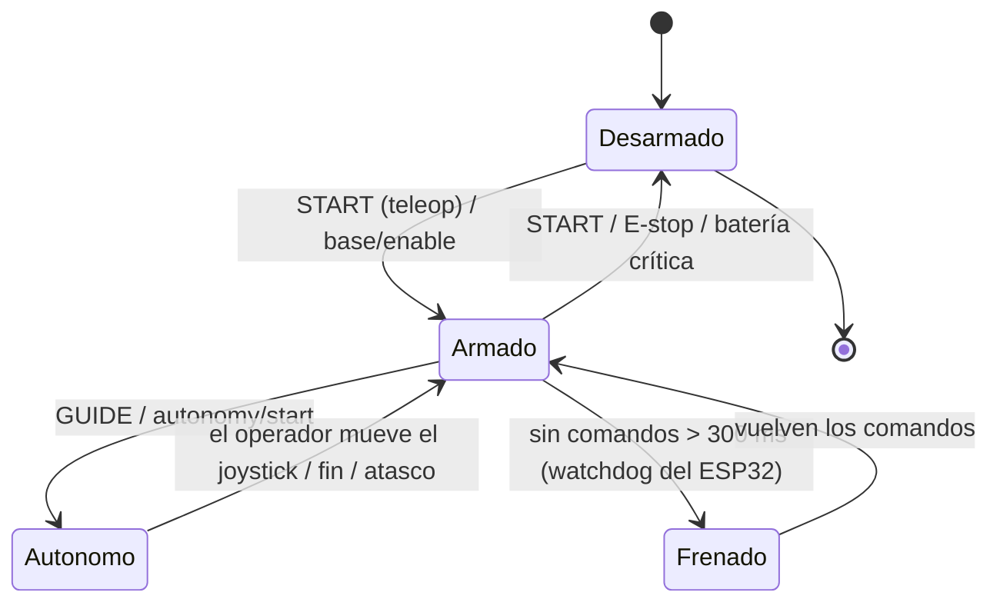

# Arquitectura del sistema

## 1. Vista general

**Reparto de tareas**: el **ESP32** hace todo lo que necesita tiempo real y que tiene que seguir siendo
seguro aunque Linux se cuelgue (lazos de motor, watchdog, E-stop). El **Jetson** hace la percepción, el
mapeo, la autonomía y la comunicación. La **notebook** solo muestra y manda comandos del joystick: el robot
tiene que poder terminar una tarea autónoma aunque el enlace se caiga.

## 2. Módulos e interfaces (ICD)

| Módulo | Hardware | Entradas | Salidas | Interfaz |
|---|---|---|---|---|
| M1 Tracción | 2× 775 + MDD20A | velocidad por oruga [m/s] | encoders | PWM 20 kHz + DIR |
| M2 Flipper | 775 + planetaria 56 mm 1:264 + MDD10A + AS5600 | ángulo o velocidad | ángulo [rad] | PWM + DIR, ADC |
| M3 Placa base | ESP32-S3 | `CMD_*` | `MSG_STATE/IMU/AUX` | USB CDC, [protocolo](../05-software/firmware.md) |
| M4 Potencia | 6S + fusibles + contactor | E-stop | 24 V actuadores / 24 V lógica / 12 V / 5 V | XT60, ATO |
| M5 Cómputo | Jetson Orin Nano | sensores | ROS 2 | USB 3, Ethernet |
| M6 LiDAR 3D | Livox Mid-360 | — | `/livox/lidar`, `/livox/imu` | Ethernet 100 Mbps (IP fija) |
| M7 Visión | Orbbec/RealSense, térmica, 3× USB | — | imágenes | USB |
| M8 Brazo | 7× STS3215 + adaptador | objetivos articulares | posiciones | TTL half-duplex 1 Mbps |
| M9 Comunicaciones | 2 routers 5 GHz | — | — | Ethernet / Wi-Fi |
| M10 Audio | placa USB + micrófono + parlante | voz del operador | audio ambiente | GStreamer/Opus por UDP |

## 3. Grafo ROS 2 (tópicos principales)

### Tópicos y servicios

| Nombre | Tipo | Publica → consume | Notas |
|---|---|---|---|
| `/cmd_vel_teleop` | Twist | joy_teleop → lane_traverse (mux) | Si el operador lo mueve, se cancela la autonomía |
| `/cmd_vel` | Twist | lane_traverse (mux) → base_bridge | Único comando que llega a las orugas |
| `/flipper/position_cmd` | Float64 [rad] | teleop, auto_flipper → base_bridge | 0 = horizontal, + = punta arriba |
| `/flipper/velocity_cmd` | Float64 [rad/s] | teleop → base_bridge | |
| `/odom` | Odometry | base_bridge | Orugas + yaw del IMU |
| `/Odometry` | Odometry | fast_lio | Base de la TF `odom→base_footprint` (odom_relay) |
| `/imu/data` | Imu | base_bridge | BNO055 en modo IMUPLUS (sin magnetómetro) |
| `/base/status` | BaseStatus | base_bridge | Batería, fallas, E-stop, enlace |
| `/arm/joint_states` | JointState | arm_driver | |
| `/arm/cartesian_jog` | Twist | teleop → arm_driver | lineal xyz, `angular.y` = cabeceo, `.z` = base, `.x` = giro |
| `/arm/set_named_pose` | SetNamedPose (srv) | → arm_driver | `stow`, `ready`, `inspect_front`... |
| `/perception/detections` | DetectionArray | detectores → poi_manager | |
| `/poi/list` | PoiArray | poi_manager → exporter | Confirmados (≥ 3 vistas) |
| `/qr/text` | String | qr_detector → operador / autonomía | |
| `/mission/start`, `/mission/export` | Trigger (srv) | → mission_exporter | Escribe TIFF, PLY y CSV |
| `/autonomy/start`, `/autonomy/stop` | Trigger (srv) | → lane_traverse | También con el botón GUIDE |
| `/base/enable` | SetBool (srv) | teleop (START) → base_bridge | Armar o desarmar |

## 4. Árbol de TF

- `map→odom`: identidad, publicada por `odom_relay` (FAST-LIO ya da una odometría global sin deriva apreciable
  en recorridos de 20 min). Sin LiDAR, `base_bridge` publica `odom→base_footprint` con orugas + IMU.
- `odom→base_footprint`: **una sola fuente** (o `odom_relay` o `base_bridge`), nunca las dos. El bringup lo
  maneja con el argumento `lio:=true|false`.
- `camera_init` (origen de las nubes de FAST-LIO) y `body` (IMU del Mid-360) los publica `odom_relay` como TF
  estáticas, para que `/cloud_registered`, `/Laser_map` y `/cloud_registered_body` se puedan usar en `map`.
- Con FAST-LIO, el driver Livox publica `CustomMsg` (no `PointCloud2`): para ver el LiDAR en RViz/Foxglove usar
  `/cloud_registered` o `/cloud_registered_body`.
- `base_footprint` está en el piso, en el centro entre los ejes. El PLY del reglamento usa como origen el
  **frente** del robot: el exportador lo corrige con `front_offset`.

## 5. Estados del robot y seguridad

Capas de seguridad, de la más dura a la más blanda:

1. **E-stop físico**: abre el contactor y deja sin energía a drivers y servos (la Jetson sigue prendida).
2. **Firmware**: si el bus de motores no tiene tensión, desarma y exige volver a armar. Watchdog de 300 ms,
   batería crítica, sobrecorriente, atasco del flipper y límites del flipper.
3. **base_bridge**: deja de mandar `cmd_vel` si pasan 0.5 s sin comandos; se desarma al detectar el E-stop.
4. **joy_teleop**: hombre muerto (LB); si el joystick se desconecta, publica cero.
5. **lane_traverse**: cualquier movimiento del operador cancela la autonomía; si detecta un atasco, se recupera
   3 veces y después aborta.

LEDs de estado (tira WS2812): verde = armado · verde tenue = desarmado · **azul = autónomo** ·
naranja titilando = sin comandos · naranja fijo = batería baja · rojo = falla · rojo titilando = E-stop.
