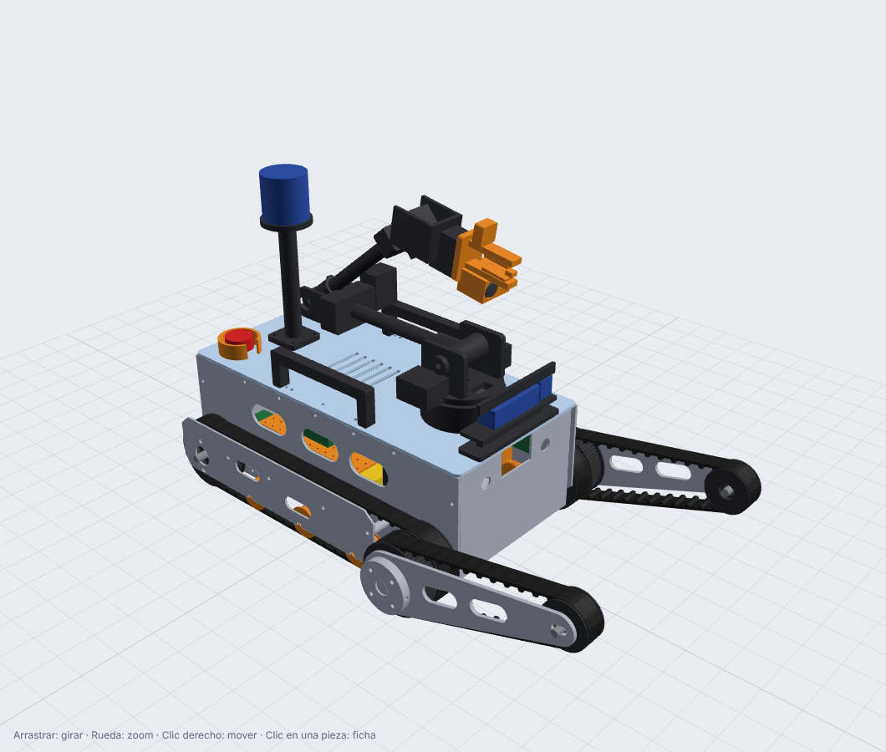
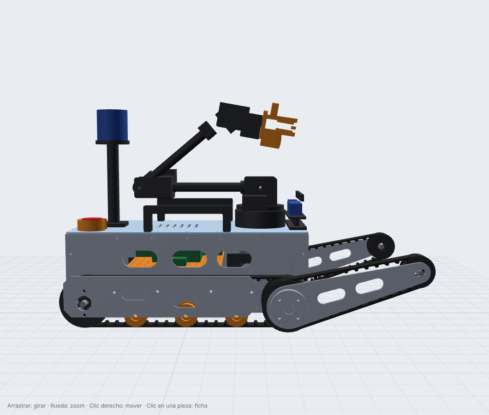
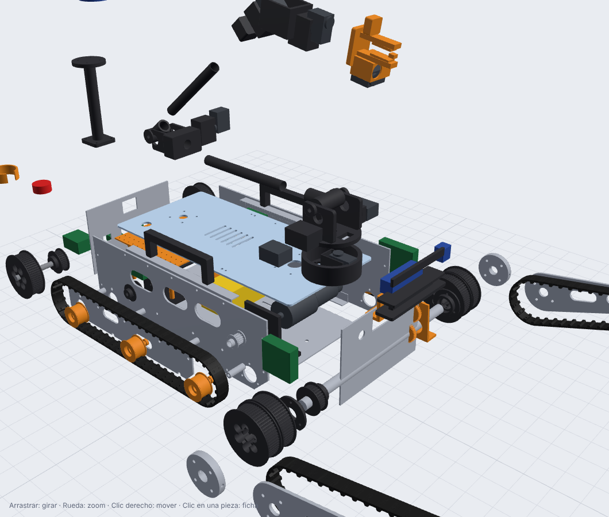

# Diseño mecánico



| | |
|---|---|
|  |  |

- **Visor 3D interactivo**: [`visor/`](../../visor/) (despiece, ficha de cada pieza, descargas).
- **Catálogo de piezas** (generado): [piezas.md](piezas.md)
- **Cálculos** (generados): [calculos.md](calculos.md) · masa y CG: [`cad/out/masa_cg.md`](../../cad/out/masa_cg.md)

## 1. Concepto

Robot de orugas con **dos flippers delanteros sobre un mismo tubo**. El cuerpo es una "caja" de dos placas
laterales de aluminio unidas por piso, deck y mamparos. Cada oruga queda entre la placa lateral y una
**placa exterior**, unidas por separadores que pasan *dentro* del lazo de la correa. Así los ejes y los
rodillos quedan apoyados de los dos lados.

| Característica | Valor |
|---|---|
| Largo (orugas) / con flippers extendidos | 519 / 759 mm |
| Ancho total | 414 mm |
| Altura del deck / con LiDAR | 194 / 445 mm |
| Distancia entre ejes | 400 mm (correa HTD 1100-5M) |
| Flipper (eje a eje) | 259 mm (correa HTD 760-5M) |
| Despeje del cuerpo | 30 mm (la oruga apoya en todo el largo) |
| Masa estimada | ≈ 17 kg (diseño para 20 kg) |

## 2. Tren motriz

```
            polea compuesta delantera (DT-02)            polea motriz trasera (DT-01)
  flipper ──┐  ┌── oruga principal                              │
            ▼  ▼                                                ▼
   ( 60T | 60T )  ─── tubo de flipper Ø20 (gira) ───   ( 60T ) ── eje Ø12 ── polea 30T ◄── correa ── 20T ◄ motor 775 1:51
```

- **Orugas**: correa HTD 5M de 25 mm (dientes hacia adentro) con **tacos de TPU** (DT-05) cada 4 dientes
  (20 mm), de 8 mm de alto, en el lomo. Fijación: adhesivo de poliuretano flexible + 2 remaches POP de 3.2 mm
  con arandela en los valles entre dientes. **Validarlo en el mes 1** (riesgo R2 del plan).
- **Motrices traseras**: cada oruga tiene su motor 775 24 V con reductora planetaria 1:51 y encoder Hall.
  Los motores van **adentro**, cruzados y escalonados en X (no entran dos de 170 mm en 230 mm de ancho
  interior), y mueven el eje trasero con una correa interna HTD 5M de 15 mm, relación 1.5:1. Las correas
  son de largo comercial (300 y 425 mm) y la posición de cada motor se **calcula** para que calcen; el
  soporte DT-08 tiene ranuras de ±6 mm para tensar.
- **Polea delantera compuesta** (DT-02): una sola pieza con dos tramos dentados (oruga + flipper). Gira
  **libre** sobre el tubo de flipper con dos rodamientos 6804. La oruga principal la mueve y ella mueve la
  correa del flipper: **los flippers también traccionan**.
- **Rodillos de apoyo** (DT-03): 3 por lado, Ø40 con 608, evitan que el tramo inferior se levante entre las poleas.

## 3. Flippers

- El **tubo de Al 20×2** cruza el robot apoyado en los rodamientos 6804 de las placas laterales (FL-05). Los
  brazos de flipper (FL-01, Al 5 mm) se fijan en los extremos con cubos (FL-02) y un **pasador M5 pasante**.
- Lo mueve un motor 775 con reductora planetaria **de 56 mm 1:264** a través de una correa HTD 5M de 15 mm,
  con relación 14T→30T (2.14:1). Torque nominal ≈ 40 N·m contra 25 N·m necesarios para levantar la mitad
  delantera. **La correa salta antes de romper la reductora**: es el fusible mecánico.
- ¿Por qué no una polea grande en el tubo? El tubo está a 58 mm del piso y el piso del cuerpo a 33 mm: una
  polea de 54T bajaba hasta 11 mm del suelo. La de 30T entra con una ranura de alivio en el piso (CH-03), y
  la reducción que falta la pone la reductora (por eso es de 56 mm: aguanta ≥ 20 N·m en su eje).
- **Ángulo**: AS5600 (magnético, analógico) que lee un engranaje 1:1 con el tubo (FL-04). Se mide el
  ángulo real del flipper aunque la correa haya saltado.
- Rango: −100° (punta abajo, levanta la trompa) a +190° (plegado hacia atrás). Poses de manejo: +15° normal,
  +60° para encarar un escalón, −35° para levantar la trompa.
- Tensión de la correa del flipper: con el eje de punta M10 en la ranura de FL-01 y un tornillo tensor M4.

## 4. Chasis

| Pieza | Material | Proceso | Notas |
|---|---|---|---|
| CH-01 placa lateral ×2 | Al 5052 4 mm | láser / chorro de agua | Agujeros de rodamientos, rodillos, separadores y escuadras ya cortados |
| CH-02 placa exterior ×2 | Al 5052 3 mm | láser | Protege la oruga de costado y sostiene ejes |
| CH-03 piso | Al 3 mm | láser | Ranuras para las correas de la batería |
| CH-04 deck | Policarbonato 4 mm (prototipo) / Al 3 mm | router CNC | Transparente: se ve el estado de los LEDs |
| CH-05/06 mamparos | Al 3 mm | láser | El trasero es el panel de conectores |
| CH-07 escuadras | Al 20×20×2 | comprado + taladro | Unen piso y deck a las placas (M4) |
| CH-09 asas ×2 | PLA-CF 100 % | impresión | Obligatorias por reglamento |

**Tolerancias**: alojamientos de rodamiento impresos a +0.10 mm sobre el diámetro nominal (ajustar con una
probeta de calibración antes de imprimir todo); agujeros de bulones +0.4 mm; agujeros en aluminio cortado
con láser: pedir el diámetro nominal y repasar con broca.

## 5. Brazo C1 (5 GDL + pinza)

| Articulación | Servo(s) | Reducción | Rango | Torque de arranque |
|---|---|---|---|---|
| J1 giro de base | 1× STS3215 | directo + lazy susan | ±170° | 2.9 N·m |
| J2 hombro | **2×** STS3215 | GT2 20T→40T (2:1) | −90°…+85° | 11.6 N·m |
| J3 codo | 1× STS3215 | GT2 20T→40T (2:1) | −5°…+140° | 5.8 N·m |
| J4 cabeceo de muñeca | 1× STS3215 | directo | ±100° | 2.9 N·m |
| J5 giro de muñeca | 1× STS3215 | directo | ±178° | 2.9 N·m |
| J6 pinza | 1× STS3215 | dedos engranados | 0–105 mm | — |

- Eslabones: tubo de fibra de carbono 20×18 pegado con epoxi a encastres impresos + pasador M3.
- Longitudes: 260 / 240 / 155 mm. Alcance horizontal de 640 mm; punta hasta 0.92 m del piso.
- **Pose guardada** (`stow`): hombro −90° (eslabón 1 acostado hacia atrás sobre el deck), codo +140°,
  muñeca +50° → la cámara de la pinza queda como "periscopio" mirando al frente desde 0.29 m.
- En la punta: **cámara USB** (inspección, QR chicos), **sensor Hall SS49E** (prueba del imán) y almohadillas de
  TPU con ranura en V para tomar el eje de 6 mm de la herramienta de INSERT.
- El rango de 360° de los STS en modo posición limita cada articulación con reducción 2:1 a 180°. Además,
  los rangos de J3 (140°) y J4 (±100°) salen del **chequeo de interferencias del CAD**: más allá, el antebrazo
  choca con la horquilla del codo o la muñeca con el soporte de J4.
- **Nivel de detalle**: el brazo está diseñado a nivel de anteproyecto (envolventes de los servos, asientos con
  juego de 0.4 mm, ejes y poleas). Antes de imprimir, verificar las medidas con un STS3215 real y agregar los
  agujeros de fijación del servo (M2/M3 según el modelo). Ver [calibración](../05-software/calibracion.md) para fijar los ceros.
- **Atajo para empezar a practicar**: imprimir un brazo abierto SO-101 (usa los mismos STS3215) y montarlo
  en el deck mientras se fabrica el C1. El software (`arm_driver`) se adapta cambiando `arm.yaml`.

## 6. Sensores y soportes

- **Mástil del LiDAR** (MT-03) atrás, a 0.43 m del piso: ve por encima del brazo guardado. El Mid-360
  tiene una zona ciega cerca (`blind: 0.30` en FAST-LIO filtra el propio robot).
- **Cabezal frontal** (MT-04): cámara de profundidad + térmica, inclinadas 10° hacia abajo, más los focos LED.
- Cámara gran angular frontal detrás de una ventana en el mamparo delantero; cámara trasera en el panel trasero.
- **E-stop** atrás a la derecha con un anillo protector (MT-05): accesible para el juez, difícil de apretar sin querer.

## 7. Cómo modificar el diseño

1. Editar `cad/carpincho_cad/params.py` (o la pieza en su módulo).
2. `python cad/build.py` → regenera STEP/STL/DXF, el GLB del visor, la masa y el CG, y el xacro del URDF.
3. `python tools/gen_docs.py` → regenera las tablas de esta documentación.
4. `python tools/check_interferences.py` → chequea los choques entre las 108 piezas del ensamble y el brazo en
   7 poses (≈ 40 s). **Tiene que dar "SIN interferencias"** (también lo corre la CI).
5. `node tools/render_views.mjs` → regenera las capturas `docs/img/`.
6. Mirar el cambio en el visor y abrir un PR.

> ¿Preferís Fusion 360 / Onshape / SolidWorks / FreeCAD? Importá `cad/out/carpincho_ensamble.step` como
> referencia. Pero si cambiás la geometría, pasá el cambio a `params.py` para que el URDF y la documentación
> no queden desfasados.
