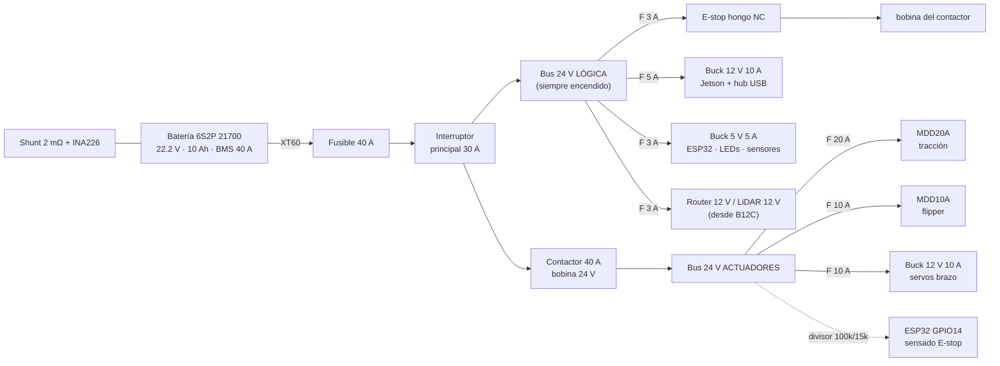

# Electrónica, potencia y cableado

## 1. Arquitectura de potencia

**Principio**: el E-stop **corta los actuadores** (motores y servos) y deja prendido el cómputo, para no
perder el mapa, los logs ni el enlace. El hongo abre el circuito de la bobina, el contactor se abre y el firmware
detecta que el bus de actuadores no tiene tensión: frena todo, **se desarma** y espera que el operador vuelva a
armar. Así, al soltar el hongo, el robot no arranca solo.

Detalles importantes:

- **Diodo de rueda libre** (1N4007) en paralelo con la bobina del contactor.
- **Precarga**: los drivers tienen capacitores grandes. Si el contactor chispea al cerrar, poner una resistencia
  de 47 Ω 5 W en paralelo con sus contactos (precarga lenta) o usar un contactor DC con supresor.
- **Shunt en el negativo** de la batería (INA226 a 0x40): mide la corriente total.
- **Todos los negativos** van a una barra común cerca de la caja de fusibles (estrella), **no** en cadena.
- Batería: con BMS de ≥ 40 A continuos, conector XT60 y **correa** que la sujete. Se carga **fuera del robot**,
  en bolsa ignífuga, y nunca sin alguien mirando.

## 2. Tabla de fusibles

| Circuito | Fusible ATO | Cable |
|---|---:|---|
| Principal (batería → interruptor) | 40 A | 12 AWG |
| MDD20A (tracción) | 20 A | 14 AWG |
| MDD10A (flipper) | 10 A | 16 AWG |
| Buck 12 V brazo | 10 A | 16 AWG |
| Buck 12 V Jetson + hub + router + LiDAR | 5 A | 18 AWG |
| Buck 5 V lógica | 3 A | 20 AWG |
| Bobina del contactor (a través del E-stop) | 3 A | 20 AWG |

## 3. Placa base (ESP32-S3-DevKitC-1) — pinout

| GPIO | Función | Conector | Notas |
|---:|---|---|---|
| 4 / 5 | Tracción izq.: PWM / DIR → MDD20A PWM1/DIR1 | J1 (JST-XH 5p) | 20 kHz, 10 bits |
| 6 / 7 | Tracción der.: PWM / DIR → MDD20A PWM2/DIR2 | J1 | |
| 15 / 16 | Flipper: PWM / DIR → MDD10A PWM1/DIR1 | J2 (JST-XH 5p) | |
| 17 / 18 | Canal libre MDD10A (enrollador de cable / reserva) | J2 | |
| 8 / 9 | Encoder izq. A / B | J3 (JST-XH 4p) | ⚠ si el encoder es de 5 V: divisor 10k/20k o alimentarlo a 3.3 V |
| 10 / 11 | Encoder der. A / B | J4 (JST-XH 4p) | ídem |
| 1 | AS5600 OUT (ángulo del flipper) | J5 (JST-XH 3p) | ADC1, atenuación 11 dB; AS5600 a 3.3 V |
| 2 | Hall SS49E (punta del brazo) | J6 (JST-XH 3p) | ADC1; cable trenzado por el brazo |
| 12 / 13 | I2C SDA / SCL: BNO055 (0x28), INA226 (0x40) | J7 (JST-XH 4p) | 400 kHz, pull-ups de 4.7 k |
| 14 | Sensado del bus de actuadores (E-stop) | J8 | divisor 100 k / 15 k desde 24 V → 3.1 V |
| 21 | WS2812 (8 LEDs de estado) | J9 (3p) | resistencia de 330 Ω en serie |
| 39 | MOSFET de los focos LED (PWM) | J10 | módulo MOSFET de nivel lógico |
| 40 | Buzzer | J10 | |
| USB nativo (19/20) | Enlace con el Jetson | USB-C "USB" | **No** usar el puerto "UART" |

Los pines evitan los de arranque (0, 3, 45, 46), el USB, la PSRAM octal (35-37) y el LED RGB de la placa.

> **PCB-01**: en la fase 1, armar todo esto en una placa perforada con borneras y conectores JST-XH.
> En la fase 2, diseñar el PCB (KiCad) con los mismos conectores.

## 4. Estándar de conectores (¡que nadie invente el suyo!)

| Uso | Conector | Color / regla |
|---|---|---|
| Batería y buses de potencia | XT60 (batería macho en el robot) | rojo + / negro − |
| Motores | XT30 | en el motor macho, en el driver hembra |
| Sensores y señales | JST-XH 2.54 | pin 1 = GND siempre |
| Servos del brazo | 3 pines Feetech (el original) | en cadena (daisy-chain) |
| Pasamuros del panel trasero | GX12 (aviador) / RJ45 pasamuro | carga, Ethernet, USB de depuración |

**Etiquetar los dos extremos de cada cable** con el ID de la tabla (impresora de etiquetas o termocontraíble
impreso).

## 5. Tabla de cableado (arneses)

| ID | Desde | Hasta | Señal | Cable | Largo aprox. |
|---|---|---|---|---|---:|
| W01 | Batería | Fusible principal | B+ / B− | 12 AWG | 15 cm |
| W02 | Interruptor | Contactor + barra de lógica | 24 V | 12 AWG | 10 cm |
| W03 | Contactor | Caja de fusibles de actuadores | 24 V ACT | 12 AWG | 10 cm |
| W04 | Fusible 20 A | MDD20A VB | 24 V | 14 AWG | 25 cm |
| W05 | MDD20A MA | Motor izq. | M+/M− | 16 AWG, XT30 | 20 cm |
| W06 | MDD20A MB | Motor der. | M+/M− | 16 AWG, XT30 | 25 cm |
| W07 | Fusible 10 A | MDD10A VB | 24 V | 16 AWG | 30 cm |
| W08 | MDD10A MA | Motor flipper | M+/M− | 16 AWG, XT30 | 15 cm |
| W09 | Fusible 10 A | Buck 12 V brazo | 24 V | 16 AWG | 30 cm |
| W10 | Buck 12 V brazo | Adaptador de servos + J1 | 12 V | 16 AWG | 20 cm |
| W11 | Fusible 5 A | Buck 12 V cómputo | 24 V | 18 AWG | 20 cm |
| W12 | Buck 12 V cómputo | Jetson (plug 5.5×2.5) + hub + router + LiDAR | 12 V | 18 AWG | 30 cm |
| W13 | Fusible 3 A | Buck 5 V | 24 V | 20 AWG | 20 cm |
| W14 | Buck 5 V | Placa base (5 V), LEDs | 5 V | 20 AWG | 15 cm |
| W15 | Placa base J1 | MDD20A (PWM/DIR ×2 + GND) | señal | 5 hilos 24 AWG | 30 cm |
| W16 | Placa base J2 | MDD10A | señal | 5 hilos 24 AWG | 30 cm |
| W17 | Placa base J3/J4 | Encoders de los motores | 3.3 V, GND, A, B | 4 hilos 24 AWG mallado | 30 cm |
| W18 | Placa base J5 | AS5600 | 3.3 V, GND, OUT | 3 hilos 24 AWG | 25 cm |
| W19 | Placa base J6 | Hall de la punta del brazo | 3.3 V, GND, OUT | 3 hilos trenzados por el brazo | 90 cm |
| W20 | Placa base J7 | BNO055 + INA226 | I2C | 4 hilos | 15 cm |
| W21 | Bus actuadores | Placa base J8 (divisor) | sensado | 22 AWG | 20 cm |
| W22 | Fusible 3 A → E-stop NC → bobina | Contactor | 24 V | 20 AWG | 40 cm |
| W23 | Jetson USB | Placa base (USB-C) | datos | USB corto con ferrite | 30 cm |
| W24 | Jetson Ethernet | Switch o router → Livox (IP 192.168.1.1xx) | datos | Cat6 plano | 30 cm |
| W25 | Hub USB | Cámaras RGB-D, térmica, frontal, trasera, pinza; adaptador de servos; audio | datos | USB | varios |

> El Livox Mid-360 y el router usan Ethernet: con un **switch mini de 5 puertos a 12 V** (o un router con
> varios puertos LAN) alcanza para Jetson + LiDAR + router.

## 6. Ruteo de cables y buenas prácticas

- Separar los **cables de potencia de motores** de los de **señal** (encoders, I2C): por lados distintos del
  robot o cruzándolos a 90°.
- Encoders con cable mallado y la malla a GND **solo** del lado de la placa.
- Dejar un **lazo de servicio** de cables en los pasajes del brazo (J1 gira ±170°): pasa por el centro de la base.
- Precintos cada 10 cm, sin ajustar de más. Nada de cables cruzando por arriba de las poleas.
- Antes de energizar por primera vez: **medir continuidad y que no haya corto** entre B+ y B− en cada bus.

## 7. Prueba eléctrica de aceptación (P-ELE)

1. Sin batería: continuidad y aislación de cada bus. Polaridad de cada XT60 y XT30.
2. Con fuente de laboratorio a 24 V y límite de 2 A: encender la lógica y medir 12 V y 5 V.
3. E-stop: con el hongo apretado, 0 V en el bus de actuadores, la Jetson sigue prendida y el LED rojo titila.
4. Soltar el hongo: el robot **no** se mueve hasta apretar START.
5. Batería real: corriente en reposo (≈ 1.2-1.5 A con todo prendido) e INA226 contra la pinza amperométrica.
