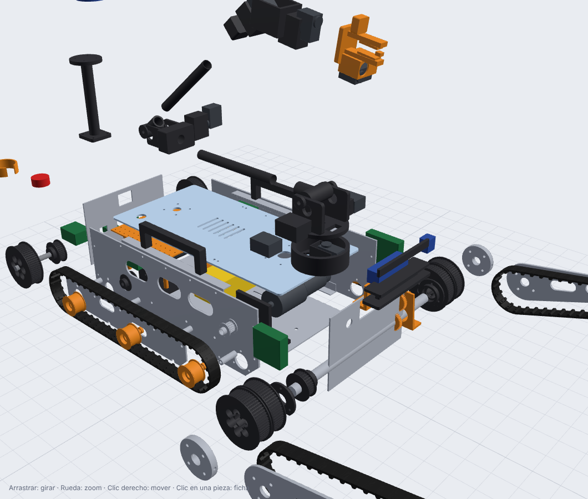

# Guía de armado del Carpincho URB-R1

Usá el **[visor 3D](../../visor/)** al lado de esta guía: buscá el código de cada pieza (por ejemplo `DT-02`)
y aparece resaltada. Las cantidades salen del [catálogo de piezas](../03-mecanica/piezas.md).

**Tiempo estimado**: 3 jornadas de 2 personas (sin contar impresión ni corte).
**Convención**: "izquierdo" y "derecho" mirando el robot **desde atrás** (como si lo manejaras). +Y es la izquierda.

## 0. Antes de empezar

### Herramientas
Llaves Allen 2/2.5/3/4/5, llaves fijas 8/10/13/17, destornilladores, calibre, escuadra, **torquímetro chico**
(1-10 N·m), soldador con punta para insertos térmicos, prensa o morsa con mordazas blandas, lima, broca de
repaso de 4/5/6/8/12/20 mm, multímetro, pelacables, crimpeadora JST y Dupont, soldador de estaño, pistola de
calor, Loctite 243 (azul), grasa de litio, adhesivo de PU flexible, epoxi de 2 componentes.

### Control de las piezas
- [ ] Imprimir primero la **probeta de rodamientos** (o una DT-03) y verificar que el 608 y el 6804 entren a
      presión firme con la mano o la morsa. Si quedan flojos o no entran, corregir la expansión horizontal del slicer.
- [ ] Repasar con broca todos los agujeros de las placas cortadas (el láser deja conicidad).
- [ ] Limar las rebabas de las placas y redondear los cantos expuestos.
- [ ] Poner los **insertos térmicos** en todas las piezas impresas que los lleven, antes de armar.

### Pares de apriete (bulonería clase 8.8 / A2 en aluminio)

| Rosca | En aluminio o plástico con inserto | Acero contra acero |
|---|---:|---:|
| M3 | 0.8 N·m | 1.2 N·m |
| M4 | 1.8 N·m | 2.9 N·m |
| M5 | 3.5 N·m | 5.7 N·m |
| M8 (ejes de rodillo) | — | 12 N·m (con tuerca autofrenante) |
| M10 (eje de punta del flipper) | — | 20 N·m (con tuerca autofrenante) |

**Loctite azul** en todo bulón que no tenga tuerca autofrenante y que esté cerca de un motor (vibración).

---

## A. Chasis (caja)

1. **A1 · Escuadras al piso.** Atornillar las 2 escuadras inferiores CH-07 al piso CH-03 (M4, sin apretar del todo).
2. **A2 · Placas laterales.** Presentar las placas CH-01 izquierda y derecha. Atornillar las escuadras a
   las placas (M4). Verificar con la escuadra que las placas queden **perpendiculares** al piso.
3. **A3 · Mamparos.** Atornillar los mamparos CH-05 (delantero) y CH-06 (trasero) entre las placas (M4).
   Ahora sí, apretar todo al par. **Medir las diagonales** de la caja: no pueden diferir en más de 1 mm.
4. **A4 · Alojamientos del tubo de flipper.** Atornillar los FL-05 a la cara **interior** de cada placa
   lateral, sobre el agujero de Ø34 (3× M4 con inserto). Meter a presión un **6804** en cada uno.
   - ✅ *Control*: pasar un tubo de 20 mm de prueba por los dos rodamientos; tiene que girar suave y sin forzar.

## B. Tren motriz trasero (de a un lado)

5. **B1 · Motores.** Atornillar cada motorreductor 775 (1:51) a su soporte DT-08 (4× M4 en PCD 32, con Loctite).
   Calzar la polea **DT-06 (20T)** en el eje del motor, con el prisionero sobre el plano del eje.
6. **B2 · Soportes al piso.** Presentar los soportes DT-08 en las ranuras del piso: el **izquierdo** más atrás
   y el **derecho** más adelante (van escalonados). Bulones M5 **sin apretar** (después se tensa la correa).
7. **B3 · Eje motriz.** Montar en este orden, desde adentro hacia afuera, sobre el eje de 12 mm:
   polea **DT-07 (30T)** → rodamiento **KFL001** (cara interior de la placa lateral) → *placa lateral* →
   polea **DT-01 (60T)** con chaveta y prisioneros. El KFL001 exterior y la placa exterior CH-02 se ponen en el paso C5.
8. **B4 · Correa interna.** Poner la correa HTD **300-5M-15** (izquierda) o **425-5M-15** (derecha) entre la 20T y la 30T.
   Correr el soporte del motor en la ranura hasta tensar: apretando con un dedo en el centro del tramo, tiene
   que flexionar **≈ 4 mm**. Apretar los M5 del soporte.
   - ✅ *Control*: girar la oruga a mano: suave, sin puntos duros. Las poleas alineadas (regla apoyada en las caras).

## C. Orugas

9. **C1 · Tacos.** Pegar los tacos DT-05 a la correa HTD 1100-5M-25 (lado liso) cada **4 dientes**,
   usando la **plantilla de pegado** (un tramo de correa vieja con los tacos marcados). 55 tacos por correa.
   - Limpiar con alcohol isopropílico, lijar el lomo con lija 120 y poner adhesivo PU en las dos caras.
   - Remachar con POP de 3.2 mm + arandela, por los 2 agujeros del taco, en el **valle** entre dientes.
   - Dejar curar 24 h (según el adhesivo).
10. **C2 · Rodillos.** Armar los rodillos DT-03 (con 608) sobre bulones M8×60, con los separadores CH-10 contra
    la placa lateral (3 por lado). Por ahora quedan en voladizo: la placa exterior se pone al final.
11. **C3 · Polea delantera.** Calzar en el tubo de flipper, de cada lado, la polea compuesta **DT-02** (con sus 2
    rodamientos 6804) por fuera de la placa lateral. Pasar el tubo a través de los FL-05 de los dos lados.
    El tubo tiene que sobresalir lo mismo de cada lado (medir).
12. **C4 · Pasar la oruga.** **Sin** la placa exterior, pasar la correa con tacos alrededor de la polea trasera,
    por debajo de los rodillos y por la sección interior de la DT-02.
13. **C5 · Cerrar con la placa exterior.** Pasar los 4 separadores CH-08 por **dentro del lazo** de la oruga, entre
    el tramo de arriba y el de abajo. Presentar la placa exterior CH-02 sobre el KFL001 exterior, los rodillos y
    los separadores, y apretar todo (bulones M5 pasantes y tuercas M8 autofrenantes).
    - ✅ *Control*: la oruga no roza la placa en ningún punto y los tacos no tocan los bulones de los rodillos.
    - La **tensión** de la oruga principal sale de la distancia entre ejes, que es fija (400 mm, calculada para la
      1100-5M). Si quedó floja por la fabricación, agregar el rodillo tensor de la v2 (backlog).
    - Para **cambiar una oruga** en la competencia se repite C4-C5: sacar la placa exterior (8 bulones), y listo.

## D. Flippers

14. **D1 · Polea de punta.** Rodamientos 6900 en la DT-04. Bulón M10×60 por el FL-01 → DT-04 → arandela → tuerca.
15. **D2 · Brazo al tubo.** Poner la correa HTD 760-5M-25 con tacos (38) en la sección exterior de la DT-02 y en
    la DT-04. Calzar el brazo FL-01 en el extremo del tubo y el cubo FL-02 por fuera.
16. **D3 · Fase.** Los dos flippers tienen que quedar **paralelos**. Con el robot sobre una mesa, poner los dos
    brazos horizontales (nivel), pasar el bulón M5×80 (12.9) por cubo y tubo y apretar. Si el agujero del tubo
    no coincide, taladrar el tubo **con el cubo como guía** (en el segundo flipper, después de fijar el primero).
17. **D4 · Tensión de la correa del flipper.** Tirar del eje de punta en la ranura con el tornillo tensor M4
    hasta que la correa flexione ≈ 5 mm en el medio. Apretar la tuerca M10.
18. **D5 · Transmisión del flipper.** En el tubo (adentro, lado derecho): polea **DT-10 (30T)** con pasador M5
    (pasa por la ranura de alivio del piso). Motor 775 con reductora de 56 mm 1:264 + soporte DT-11 + polea
    **DT-09 (14T de aluminio)**. Correa **300-5M-15**; tensar con la ranura del soporte.
19. **D6 · Sensor de ángulo.** Engranaje partido FL-04a en el tubo (lado izquierdo, a 40 mm del centro), soporte
    FL-04c atornillado al piso, engranaje FL-04b con el imán diametral en sus 2 rodamientos MR105. El PCB del
    AS5600 en los postes, a **1-2 mm** del imán.
    - ✅ *Control*: girar los flippers a mano en todo el rango: nada choca y los engranajes no saltan.

## E. Potencia y electrónica

> Hacerlo **sin la batería conectada**. Seguir la [tabla de cableado](../04-electronica/electronica.md#5-tabla-de-cableado-arneses).

20. **E1 · Cuna de batería** MT-02 al piso, con la correa de velcro pasada por las ranuras.
21. **E2 · Tablero de potencia** en la zona trasera del piso: caja de fusibles, contactor (con diodo), barra
    de negativos, shunt e interruptor principal en el mamparo trasero.
22. **E3 · Drivers** MDD20A (cara interior de la placa izquierda) y MDD10A (placa derecha), sobre separadores de nylon.
23. **E4 · Bandeja MT-01** sobre sus columnas: Jetson, placa base (ESP32), conversores 12 V ×2 y 5 V.
24. **E5 · Arneses** W01-W25. Etiquetar los dos extremos de cada cable. Encoders con cable mallado.
25. **E6 · Prueba eléctrica** P-ELE (sección 7 de electrónica) **antes** de conectar la Jetson y los sensores.
26. **E7 · Deck CH-04**: pasar los cables del brazo, el LiDAR y el E-stop por sus agujeros y atornillar el deck
    a las escuadras superiores. Montar el **E-stop** con su protección MT-05 y las **asas** CH-09.

## F. Sensores

27. **F1** · Mástil MT-03 (tubo Al 25×2 pegado en base y plato) + Livox Mid-360 (cable hacia abajo por el tubo).
28. **F2** · Cabezal frontal MT-04: cámara de profundidad, térmica y focos. Cámara frontal en MT-06 detrás del
    mamparo; trasera en el panel trasero.
29. **F3** · Cada cámara en **su puerto fijo** del hub USB (etiquetado) para que las reglas udev funcionen.

## G. Brazo C1

30. **G1** · Configurar los IDs de los servos **antes** de montarlos (`tools/arm_tool.py setid`), con una etiqueta en cada uno.
31. **G2** · Base AR-01 al deck (6× M4) con el servo J1. Lazy susan + torreta AR-02.
32. **G3** · Servos J2 (×2) en la torreta, con poleas GT2 20T en los horns. Eje del hombro de 8 mm con 608 en las
    mejillas y el cubo AR-03 (GT2 40T ×2). Correas GT2 cerradas.
33. **G4** · Tubo del eslabón 1 pegado con epoxi en AR-03 y AR-04 (con pasador M3). Codo con el servo J3.
34. **G5** · Eslabón 2 (AR-05a + tubo + AR-05b) y muñeca (J4, AR-06, J5) y pinza AR-07 (J6, cámara y Hall).
35. **G6** · Cables de servos en cadena por dentro de los tubos o con espiral, con **lazo de servicio** en cada
    articulación. Calibrar los ceros (`tools/arm_tool.py zeros`).

## H. Primera puesta en marcha

36. Robot **sobre un soporte** (orugas en el aire). Batería conectada, E-stop **apretado**, interruptor ON.
    La Jetson arranca y los LEDs titilan en rojo (E-stop).
37. Soltar el E-stop: LEDs en verde tenue (desarmado). `ros2 topic echo /base/status`: batería ≈ 24-25 V, `link_ok: true`.
38. START en el joystick (arma) → avanzar despacio con LB + stick. Verificar el sentido de cada oruga.
    Apretar el E-stop con las orugas girando: **tienen que parar al instante**.
39. Calibraciones en el orden de [calibracion.md](../05-software/calibracion.md).
40. Recién después, al piso. Primero en plano, después rampa, después escalón.

## Checklist de fin de armado

- [ ] Todos los bulones con el par indicado (marcarlos con una línea de pintura: sirve para ver si se aflojan)
- [ ] Nada roza: girar orugas y flippers a mano en todo el rango
- [ ] Prueba P-ELE completa y E-stop verificado con los motores andando
- [ ] Pesar el robot y anotarlo (comparar con `cad/out/masa_cg.md`)
- [ ] Foto de cada subsistema para la documentación y el TDP
